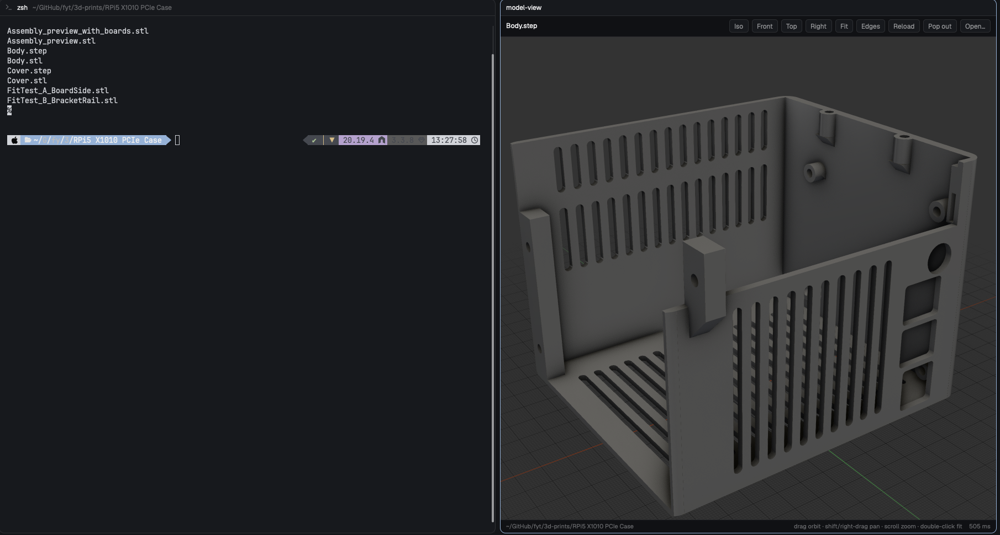

# Model view

A [Herdr](https://herdr.dev) mod that shows a 3D model (STL, STEP, 3MF, OBJ,
glTF and more) in a pane, next to your terminals. Drag to orbit, scroll to
zoom, and it re-renders when the file changes on disk, so an export from your
CAD tool or an agent's edit shows up at once.



- **Orbit, pan, zoom:** drag to orbit, Shift-drag or right-drag to pan,
  scroll or pinch to zoom, double-click to fit.
- **Views:** Iso, Front, Top and Right buttons, Fit, and an Edges toggle.
- **Live reload:** the pane watches the file and renders it again when it
  changes.
- **Pick a model:** opened without a file, the pane lists the models under
  the focused terminal's folder.
- **Pop out:** opens the same model in [f3d](https://f3d.app)'s own window,
  for real-time GPU orbiting outside Herdr (needs the `f3d` app).

## How it works

Herdr mods can't host a GPU surface, so the pane shows rendered frames. A
small helper (`helper.py`) keeps one [f3d](https://f3d.app) engine running
offscreen (on the GPU) and renders each view to an image. While you drag, it
sends small JPG frames (about 30 ms each); when you stop, a full-resolution
PNG with ambient occlusion.

## Install

### Ask your agent

In a Herdr terminal, paste this to your coding agent:

```text
Read ~/.config/herdr-app/AGENTS.md, then add this mod: https://github.com/Bucknalla/herdr-model-view
```

### Or by hand

```sh
git clone https://github.com/Bucknalla/herdr-model-view
cp -R herdr-model-view/mods/model-view ~/.config/herdr-app/mods/model-view
herdr-app check ~/.config/herdr-app/mods/model-view
```

### Set up the renderer, once

The helper needs the `f3d` Python package (about 200 MB, with VTK and
OpenCASCADE for STEP) in its own venv. With [uv](https://docs.astral.sh/uv/):

```sh
uv venv -p 3.12 ~/.local/share/herdr-model-view/venv
uv pip install -p ~/.local/share/herdr-model-view/venv/bin/python f3d
```

Or with Python 3.11 or newer:

```sh
python3 -m venv ~/.local/share/herdr-model-view/venv
~/.local/share/herdr-model-view/venv/bin/pip install f3d
```

The pane shows these commands if the venv is missing. For **Pop out**, also
install the f3d app (`brew install f3d` on macOS).

### Requirements

- The Herdr desktop app on macOS (tested on Apple Silicon, macOS 26). The
  f3d package has wheels for macOS 14+ (arm64), Linux (x86_64) and Windows;
  Linux should work but is untested, and Windows is not supported (the mod
  uses `sh` and `curl`).
- `curl` and `find` (both ship with macOS).

## Open a model

```sh
# beside the focused pane
herdr-app do pane.split --direction right --mod model-view --props '{"file":"/path/to/part.step"}'

# in a new tab
herdr-app do tab.new --name part --mod model-view --props '{"file":"/path/to/part.stl"}'
```

Without `props`, the pane lists the models it finds.

### For coding agents

An agent in a Herdr terminal can open a model beside itself. Herdr puts the
agent's terminal id in `HC_TERMINAL_ID`; split that terminal's pane, not the
focused one (which may be in another tab):

```sh
pane=$(herdr-app ls | python3 -c 'import json,os,sys
for s in json.load(sys.stdin)["spaces"]:
  for t in s["tabs"]:
    for x in t["terminals"]:
      if x["terminal"].split("/")[-1] == os.environ["HC_TERMINAL_ID"]: print(x["pane"])')
herdr-app do pane.split --pane "$pane" --direction right --mod model-view --props '{"file":"/abs/path/part.step"}'
```

The pane re-renders when the file changes, so after an agent exports the
model again (from FreeCAD, OpenSCAD, CadQuery, ...) there is no need to open
it again. Tell your agent with a line in its instructions (`CLAUDE.md`,
`AGENTS.md`), for example: "To show me a 3D model in Herdr, open it in a
model-view pane beside your own pane (see github.com/Bucknalla/herdr-model-view)."

### Commands

Bind them in `keys.json` or run them with `herdr-app do` (shown panes only):
`model-view.iso`, `.front`, `.back`, `.left`, `.right`, `.top`, `.bottom`,
`.fit`, `.edges`, `.reload`, `.popout`, `.orbit:<degrees>`,
`.tilt:<degrees>`, `.zoom:<factor>`, `.open:<path>`.

## What it does on your computer

- **Runs programs:** the helper (`~/.local/share/herdr-model-view/venv/bin/python`
  with `helper.py`), `curl` to talk to it, `find` to list models, `sh` to
  start the helper, and `f3d` for Pop out.
- **Listens on 127.0.0.1:47391.** Every request must carry a random token
  that the helper writes to `~/.local/share/herdr-model-view/token` (mode
  600). It only opens files with a 3D model extension. It quits after 15
  minutes without a request.
- **Reads** the model files you open, and lists files under the focused
  folder (4 levels deep) for the picker.
- **Writes** the rendered frames to `~/.config/herdr-app/model-view-frames/`
  (the last 6 only), and its token and log to
  `~/.local/share/herdr-model-view/`.
- No network access beyond localhost.

## Remove

```sh
pkill -f model-view/helper.py
rm -rf ~/.config/herdr-app/mods/model-view ~/.config/herdr-app/model-view-frames ~/.local/share/herdr-model-view
```

## License

MIT. See `LICENSE`. Rendering by [f3d](https://f3d.app) (BSD-3-Clause).
