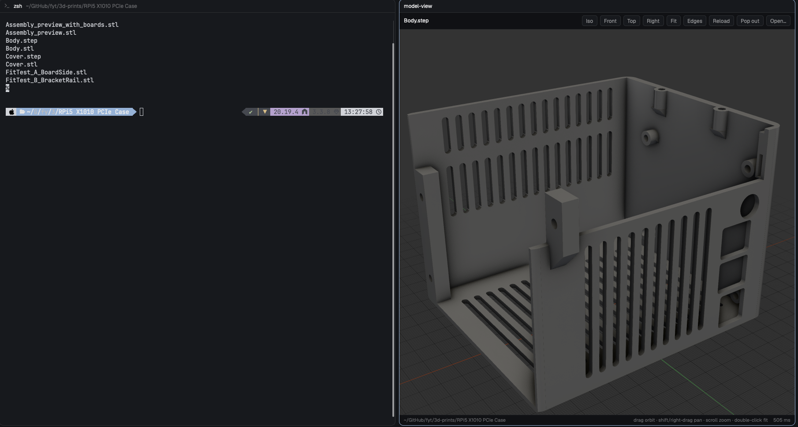

# Model view

A pane that shows one 3D model (STL, STEP, 3MF, OBJ, glTF, PLY, OFF, IGES,
BREP) beside your terminals. You orbit it by dragging, zoom with the wheel,
and it renders again when the file changes on disk. The frames come from a
long-lived f3d engine rendering offscreen on the GPU.

## What you see

Top to bottom, filling the pane:

1. **Toolbar**, 38px, `chrome` background, 1px `border` line below, 10px
   side padding, 6px gaps. On the left the file name, semibold,
   `foreground`, truncated. On the right buttons, 24px high, 8px side
   padding, radius 5, 12px text, 1px `border`, `background` fill, `muted`
   text, `hover` on hover: **Iso**, **Front**, **Top**, **Right**, **Fit**,
   **Edges** (a toggle: `accent` border, `selected` fill and `foreground`
   text while on), **Reload**, **Pop out**, **Open…**.
2. **View**, the rest, `canvas` background. The rendered frame fills it
   exactly (the frame is rendered at the view's size). f3d draws the scene:
   dark background, a grid under the model, Z up, FXAA, tone mapping;
   ambient occlusion on still frames. Before the first frame: "Rendering
   <name>…" centred, 12.5px `dim`.
3. **Footer**, 24px, `chrome`, 1px `border` line above, 11px `dim` text: the
   file's folder (home as `~`), truncated; the hint "drag orbit ·
   shift/right-drag pan · scroll zoom · double-click fit"; then "N fps"
   while dragging, else the last render time "N ms".

**Picker**, when there is no file: "Open a 3D model" semibold, "STL, STEP,
3MF, OBJ, glTF under <folder>" in 11.5px `dim`, then one row per model
(name in `foreground`, folder in 11px `dim`, radius 6, `hover` fill), or
"No models found here." / "Looking…". 16px padding, scrolls.

**Setup needed**, in place of the view when the helper's venv is missing:
"The 3D helper is not set up" semibold, "Run one of these once in a
terminal (uv, or plain Python 3.11+), then Reload:", and the two setup
commands in the terminal font, 11.5px, on `raised`, radius 6. Other
errors: one line in `ansi1`.

## How it behaves

- **Orbit:** left-drag. 0.4° per pixel; elevation clamped to ±89°.
- **Pan:** Shift- or Alt-left-drag, or right-drag. Moves the focal point in
  the camera plane, scaled to the model's size and the zoom.
- **Zoom:** wheel or trackpad (`exp(dy × 0.004)`) and pinch (`1 + delta`),
  0.05× to 50×. A full-quality frame follows 250 ms after the last step.
- **Double-click:** fit (zoom 1.15, no pan), keeping the angle.
- **Views:** Iso az −35° el 25°, Front 0/0, Back 180/0, Right 90/0, Left
  −90/0, Top 0/89, Bottom 0/−89. Azimuth 0 looks from −Y; 90 from +X.
- **Drag frames vs still frames:** while dragging or zooming, frames are
  0.75× the view's logical size, JPG, no ambient occlusion. On release (or
  pointer leaving the view), one frame at 2× (Retina), PNG, with ambient
  occlusion.
- **One request in flight:** while one renders, only the newest camera
  waits; older ones are dropped.
- **No flashing:** a new image shows nothing until Herdr has loaded it, so
  the view draws the last 4 frames stacked, newest on top.
- **Live reload:** `watchFolder` on the file's folder; when the file (or the
  folder root) is reported, 400 ms later a still frame. The helper reloads
  the model when its mtime changed.
- **Pop out:** runs `f3d <file> --up=+Z --grid --anti-aliasing` detached; a
  warning toast "f3d is not installed" when it isn't on PATH.
- **Open…:** back to the picker, listing again.
- **Agent status:** not shown; this mod has nothing to do with agents.
- **Commands** (`nextCommand`): `iso`, `front`, `back`, `left`, `right`,
  `top`, `bottom`, `fit`, `edges`, `reload`, `popout`, `close`,
  `orbit:<deg>`, `tilt:<deg>`, `zoom:<factor>`, `open:<path>`.

## Built from

- **One mod, no layout:** `mods/model-view/` with `main.js` (the pane),
  `helper.py` (the renderer) and `mod.json`
  `{ "place": "none", "title": "Model" }`. Opened as a pane:
  `pane.split {direction, mod: "model-view", props: {file}}` or
  `tab.new {mod: "model-view", props: {file}}`.
- **`herdr` functions:** `props`, `theme`, `settings` (`font_family` for the
  setup commands), `notify`, `exec`, `appHome`, `home`, `focused` (`cwd` for
  the picker), `readTextFile` (the token), `watchFolder`, `nextCommand`,
  `checking`. gpui-kit `image()` for frames; gpui-base `v_flex`, `h_flex`.
- **Events on the view `div`:** `on_size_change` (render at that size),
  `on_mouse_down` left/right, `on_mouse_move` (no button state: the mod
  keeps `drag` from down to up), `on_mouse_up`, `on_hover` (leaving ends a
  drag), `on_scroll_wheel`, `on_pinch`, `on_click` (`click_count === 2`).
- **The helper** (`helper.py`, Python 3.11+, the `f3d` PyPI package in
  `~/.local/share/herdr-model-view/venv`): `http.server.HTTPServer`
  (single-threaded: every f3d call on one thread) on 127.0.0.1:47391.
  `POST /ping` and `POST /render` with `X-Token`; the token is random per
  start, written to `~/.local/share/herdr-model-view/token` with mode 600.
  `/render` takes `{file, az, el, zoom, px, py, w, h, edges, fast}` and
  answers `{frame, file, ms}`. It loads the file when the path or mtime
  changed (`scene.clear`, `scene.add`, `camera.reset_to_bounds`; the reset's
  focal point is the centre and its distance the size), sets the whole
  camera from the request as a `CameraState` (Z up), renders with
  `render_to_image()` and saves `f-<pid>-<seq>.jpg|png` into
  `~/.config/herdr-app/model-view-frames/`, keeping the newest 6. Options:
  `scene.up_direction` +Z, `render.grid.enable`, `render.effect.ambient_occlusion`
  (off when `fast`), `render.effect.antialiasing.mode` fxaa,
  `render.effect.tone_mapping`, `render.show_edges` from `edges`. A second
  helper fails to bind and exits; the helper exits after 15 minutes idle
  and deletes its frames.
- **Starting it:** when a request can't reach the helper, the mod checks
  the venv's python (`test -x`), finds `helper.py` (its own folder, or any
  `mods/*/helper.py` containing "herdr-model-view helper"), starts it with
  `sh -c 'mkdir -p "$4"; nohup "$1" -I "$2" "$3" "$4" >"$4/helper.log"
  2>&1 </dev/null &'`, and pings every 250 ms for up to 10 s.
- **Programs:** `curl` (each request: `-X POST -H X-Token --data-raw
  <json> -w "\n%{http_code}"`), `sh`, `test`, `grep`, `find` (picker:
  depth 4, no dot folders or `node_modules`, at most 200), `f3d` (Pop out).
- **Art:** none; f3d draws the scene.

## Watch out

- **Frames must live under the app home.** `image()` resolves paths from
  `~/.config/herdr-app`, so the helper writes there. Keep them out of
  `mods/`, where a write could reload the mod.
- **Every frame is a new file name.** Draw several stacked, or the pane
  flashes empty while each new image loads.
- **`fetch` to localhost didn't reach the helper** in a live pane (Herdr
  may have a network policy for mods); `exec("curl")` does. `herdr-app
  check` can't show it: it exits before async work finishes.
- **A mod pane does nothing until it's on screen:** `on_size_change` fires
  only after the first layout, so no frame is asked for in a hidden tab.
- **Absolute camera.** The mod owns azimuth, elevation, zoom and pan and
  sends them all each time; relative `azimuth()` calls drift when a request
  is dropped or the helper restarts.
- **f3d's CLI config files don't apply to the bindings:** set Z up, the
  grid and ambient occlusion yourself. An absolute grid cuts through models
  that sit below z = 0; use the grid at the model's base.
- **`checking()`:** never start the helper or a watch during `herdr-app
  check` (`init` runs for real).
- **Speed:** on Apple Silicon a drag frame is ~12 ms to render, ~10 ms to
  write as JPG and ~8 ms for curl; STEP files take a few hundred ms to load
  the first time. Herdr redraws the whole window per frame, so the mod never
  renders on a timer.
- **macOS and Linux only** (`sh`, `curl`). Linux is untested.

## Done when

- `herdr-app check` passes for `mods/model-view`.
- `herdr-app do pane.split --direction right --mod model-view --props
  '{"file":"<a .step>"}'` shows the part, Z up, on a grid, in a second or
  less; the same for an `.stl`.
- Dragging orbits without the view going blank; the footer shows fps while
  dragging and a render time after release.
- Shift-drag pans, the wheel zooms, a double-click fits; Iso, Front, Top and
  Right show those views; Edges draws the mesh edges.
- Saving the model file from another program re-renders the pane.
- Without a file, the pane lists the models under the focused folder and a
  click opens one.
- Without the venv, the pane shows the setup commands, and after running
  one, Reload renders the model.
- `curl -X POST 127.0.0.1:47391/ping` without the token answers 403.
- Pop out opens the model in f3d's window when `f3d` is installed.
